

  

  

  
  <!-- add your links here, same style:
  
  
  -->
  
  
  

 

<!-- pipeline and profile card sit side by side at 48% each so they line up -->

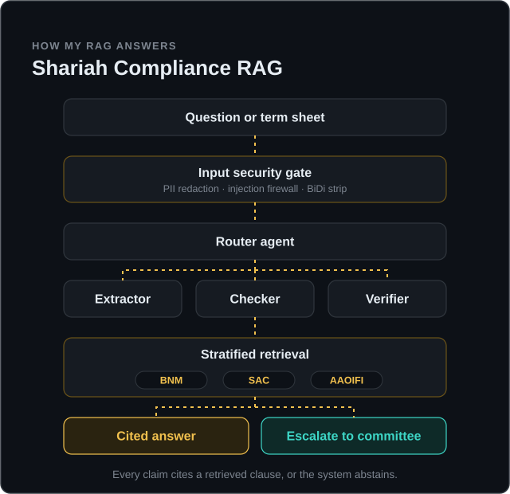

 

## About

I build AI and data projects that have to be right, not just fluent. My halal ingredient scanner says "needs review" instead of guessing, my food-price study reports its own coverage gaps, and my current project, a Shariah compliance RAG, cites a real clause for every claim or abstains.

My main interests are retrieval-augmented generation, multi-agent systems and NLP, especially where they meet Islamic finance and halal standards.

<!-- add: where you study or work, and what kind of role or collaboration you are looking for -->

## Skills and Tools

<table>
<tr>
<td width="24%"><b>AI, NLP and RAG</b> Models, OCR, retrieval</td>
<td>

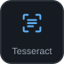
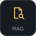

</td>
</tr>
<tr>
<td width="24%"><b>Data and Analytics</b> Cleaning, SQL, dashboards</td>
<td>
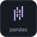
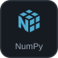
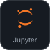
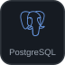
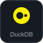
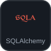
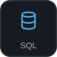
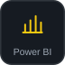
</td>
</tr>
<tr>
<td width="24%"><b>Secure Engineering</b> Tests and guardrails from day one</td>
<td>
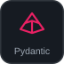
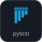
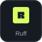

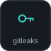
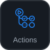
</td>
</tr>
<tr>
<td width="24%"><b>Languages and Tools</b> Building and shipping</td>
<td>

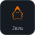
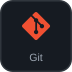

</td>
</tr>
</table>

## Featured Projects

<table>
<tr><th width="20%" align="left">Project</th><th width="58%" align="left">What it is</th><th width="22%" align="left">Stack</th></tr>
<tr><td><b>Shariah Compliance RAG</b> In progress</td><td>Retrieval and multi-agent review assistant over BNM policy documents, SAC rulings and AAOIFI standards. Cites the exact clause, shows disagreements between authorities side by side, and never issues a fatwa.</td><td>Python, Pydantic, pdfplumber, RAG</td></tr>
<tr><td><a href="https://github.com/Saadat499/foodstatus-ingredient-ner"><b>ScanHalal</b></a></td><td>Point a camera at an ingredient label and get a halal, haram or syubhah verdict per ingredient, with the evidence behind it. Fine-tuned BERT NER reaches ingredient F1 0.967 on its test set.</td><td>PyTorch, Transformers, Tesseract, Streamlit</td></tr>
<tr><td><a href="https://github.com/Saadat499/shippingdoc_verfication"><b>ShipSentry</b></a> Team of 5</td><td>Averis x Monash Hackathon 2026. Checks that a Shipping Instruction and a draft Bill of Lading describe the same shipment. I coordinated the team and worked on verification and comparison.</td><td>Python, pdfplumber, Gemini, Firebase</td></tr>
<tr><td><a href="https://github.com/Saadat499/Dormathon2026"><b>VoxelSort</b></a> Team project</td><td>Dormathon 2026. Chest X-ray worklist prioritiser for decision support; a clinician reads every scan.</td><td>Python, FastAPI, React</td></tr>
<tr><td><a href="https://github.com/Saadat499/malaysia-food-prices"><b>Malaysia Food Prices</b></a></td><td>How staple food prices move around festive periods, by state and premise type, using PriceCatcher open data, with coverage and sensitivity checks.</td><td>Python, SQL, DuckDB, Power BI</td></tr>
<tr><td><a href="https://github.com/Saadat499/customer-shopping-behavior-analysis"><b>Customer Behavior Analysis</b></a></td><td>End-to-end retail analytics: Python cleaning, ten business questions in PostgreSQL, and an interactive Power BI dashboard.</td><td>pandas, PostgreSQL, Power BI</td></tr>
</table>

## Build Progress


<!--
## Certifications

  

-->

## GitHub Activity

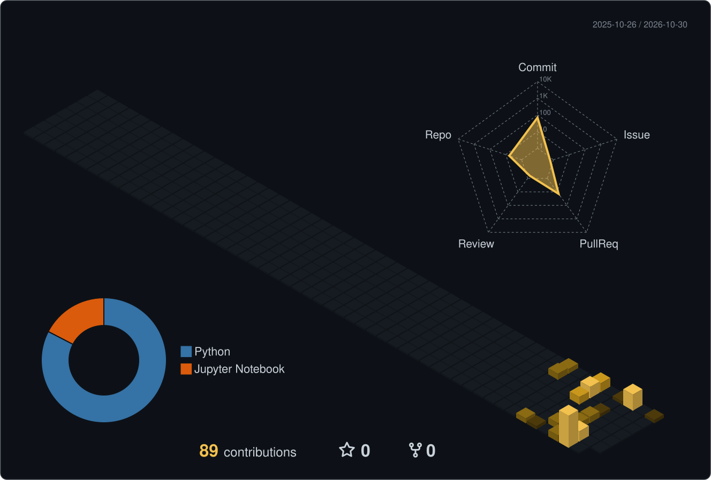

Every claim cites a source. That goes for this page too.

