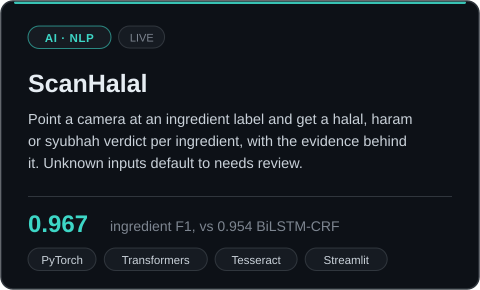
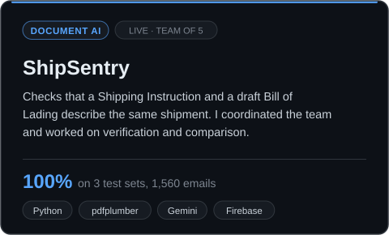
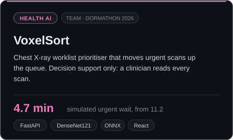
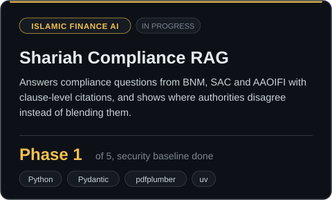
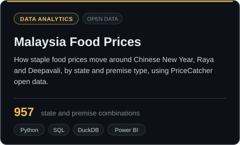
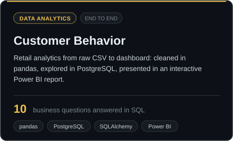
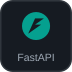

<!-- ============================================================== -->
<!--  you are reading the source. nice. every claim needs evidence,  -->
<!--  so here is yours:                                              -->
<!--  ZmxhZ3tzaG93X3lvdXJfZXZpZGVuY2Vfb3Jfc2F5X25lZWRzX3Jldmlld30=    -->
<!-- ============================================================== -->

  

  

  
  <!-- add your links here, same style:
  
  
  -->
  
  
  

 

<!-- project map and profile card sit side by side at 48% each so they line up -->

 

## About

I'm Saadat, and I build AI and data projects end to end, from messy input to something people can actually use. My first projects on GitHub were small Java OOP programs in 2025. Since then I've shipped a halal ingredient scanner, built two hackathon projects with teams, written two data analytics studies, and started a Shariah compliance RAG.

The common thread is **trust**. I like problems where a wrong answer is costly, so my systems show their evidence and say when they are unsure:

- **ScanHalal** marks an ingredient "needs review" instead of guessing halal or haram.
- **ShipSentry** checks shipping documents automatically and only sends the truly uncertain cases to a human.
- **Malaysia Food Prices** reports its coverage gaps and sensitivity checks next to every headline number.
- **Shariah Compliance RAG** cites a real clause for every claim and shows disagreements between BNM, SAC and AAOIFI instead of hiding them.

I'm most interested in AI for Islamic finance and halal standards, document AI, NLP, and evaluating models on data they have never seen.

<!-- add a line about where you study or work, and what roles or collaborations you are looking for -->

**Right now**

- **Building:** a Shariah compliance RAG over BNM policy documents, SAC rulings and AAOIFI standards
- **Recently shipped:** ScanHalal (live), ShipSentry at the Averis x Monash Hackathon 2026, VoxelSort at Dormathon 2026
- **Ask me about:** OCR and NER pipelines, honest model evaluation, SQL and Power BI dashboards

## By the Numbers

## Featured Projects

  
  

  
  

  
  

Click a card to open the repo. The Shariah Compliance RAG repo is private while it is in progress.

## Journey

## Skills and Tools

<table>
<tr>
<td width="24%"><b>AI, NLP and RAG</b> Models, OCR, retrieval</td>
<td>

</td>
</tr>
<tr>
<td width="24%"><b>Data and Analytics</b> Cleaning, SQL, dashboards</td>
<td>

</td>
</tr>
<tr>
<td width="24%"><b>Secure Engineering</b> Tests and guardrails from day one</td>
<td>

</td>
</tr>
<tr>
<td width="24%"><b>Languages and Tools</b> Building and shipping</td>
<td>

</td>
</tr>
</table>

## Now Building: Shariah Compliance RAG

<!--
## Certifications

  

-->

## GitHub Activity

psst. every claim needs a source, and there is a flag hidden in this README's source.

